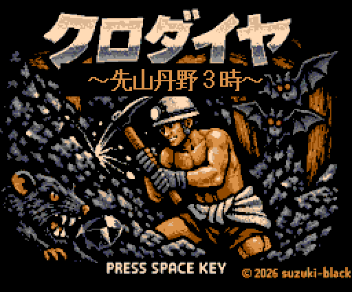
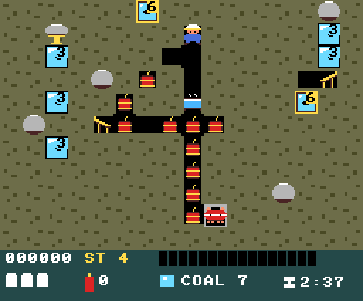
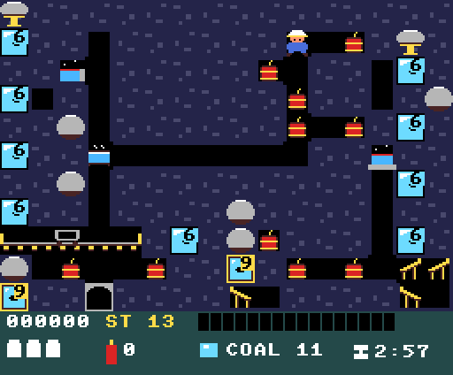

# クロダイヤ 〜先山丹野3時〜 / KURODAIYA — Black Diamond

<p align="center">
  
</p>

> ⚠️ **This is a prototype** (work in progress), published for feedback and experimentation.
> **試作品（プロトタイプ・開発中）です。** フィードバックと実験のために公開しています。

A single-screen dig-and-blast action game for the **MSX2 and later** (MSX turbo R recommended),
set in a Jōban coal mine in early-Shōwa Japan. You play **Tanno San-ji**, a *sakiyama* — the
face boss who swings the pick at the coal seam. Dig through the strata, crack the black diamonds,
and drop rocks through them so the seam comes down in one chain.

**Repository:** <https://github.com/suzuki-black/SakiyamaBlast>

<p align="center">
  
  
  <br><sub>Stage 4 · chutes and a propped rock / ステージ4 樋と支柱　　Stage 13 · mine cart and hot pools / ステージ13 鉱車と溜まり湯</sub>
</p>

**Language:** [🇬🇧 English](#english) · [🇯🇵 日本語](#japanese)

---

<a name="english"></a>
## English

- [Story](#story)
- [Overview](#overview)
- [Features](#features)
- [Controls](#controls)
- [Requirements](#requirements)
- [Building](#building)
- [Running](#running)
- [Project structure](#project-structure)
- [Documentation](#documentation)
- [Lineage — how it got here](#lineage--how-it-got-here)
- [Scope & honest positioning](#scope--honest-positioning)
- [Feedback](#feedback)
- [Credits](#credits)
- [License](#license)
- [Disclaimer](#disclaimer)

### Story

> The pit is 40°C and wet. The man who goes in first, cuts the face and decides where the
> roof will come down is the *sakiyama*. He takes a bath in cold water every half hour,
> eats a pickled plum for the salt, and goes back in.
>
> Tanno San-ji is a sakiyama. He has a pick, a stick of dynamite and a seam of black diamonds
> above his head.

### Overview

- **Target:** MSX2 or later (SCREEN 5 is required). **MSX turbo R recommended** — it holds 60fps.
  128 KB (1 Mbit) ASCII8 MegaROM.
- **Genre:** single-player, single-screen dig-and-blast action.
- **Structure:** 15 stages in 5 acts (3 stages each). The tunnel you start in is carved in the
  shape of the stage number.
- **Clear condition:** mine **every black diamond** on the board. How much you dug is a score
  bonus, not a goal.
- **The core is the chain.** A falling rock punches straight through cracked coal and mines it
  on the way down; what the rock takes and what you take on foot count as the **same chain**
  if they happen within 3 seconds.

### Features

- **Chain mining.** Crack a vertical seam, then drop a rock through it. Score doubles per link
  (200 → 400 → 800 …), the sound rises a semitone each time, and the screen shakes harder.
- **Four ways to prepare a chain**, introduced one act at a time:
  - **Push** a rock sideways to line it up over a seam (it can be pushed into dirt).
  - **Dig** — veins are laid with one cell of dirt between the segments, so a rock stops after
    one segment unless you open the gaps first.
  - **Chutes** (act 2) — a plank that deflects a falling rock one column sideways, once.
  - **Mine cart** (act 4) — carries a rock several cells along a rail and throws it off at the stop.
- **Props** — the trigger rock stands on a wooden post. While it stands the rock cannot fall,
  *even in a cave-in*. One pick swing breaks it. The order trap disappears and the trigger
  becomes a move of its own.
- **Pillars and cave-ins.** Two high-durability black diamonds per board. Break one and **every
  rock on the board falls at once**.
- **Four enemies, told apart by colour** (after the Pac-Man ghosts): red chases, pink cuts ahead,
  cyan plays off red's position, orange backs off when it gets close. They cannot dig — instead
  they turn transparent and cut diagonally through the dirt, and **the more you dig, the sooner
  they do it**. A pick swing stuns them; a falling rock kills them.
- **Body heat.** It rises with time and with every swing. Overheat and you lose a life. A tub of
  cold water cools you down if you stay in it for two seconds; a pickled plum dropped by a crushed
  enemy cools you instantly.
- **Hot water** (act 3) — a spring floods the tunnels cell by cell. Rocks dam it, items float on
  it, enemies treat it as ground they cannot cross without going transparent.
- **Per-stage time limit** (2:20–3:00). A fanfare at 30 seconds; the clock turns red; at zero it
  costs a life. Whatever is left is converted into score in a fast tally at the end of the stage.
- **Dynamite is a thrown weapon.** It flies up to five cells, explodes on the enemy it hits, and
  does not dig terrain. Powder carries over to the next stage.
- **Hidden settings menu** — the Konami code on the title screen (lives, continue, invincibility,
  starting stage, instant retry, heat haze).
- **Music on the PSG**: *Jōban Tankō-bushi* (a Jōban coal-mining folk song) in the pit and
  *Down in a Coal Mine* (J. B. Geoghegan, 1872, public domain) on the title — both transcribed
  and arranged for three channels for this game.
- **FM (MSX-MUSIC) on top, without a single extra byte of song data.** Whenever a PSG voice
  changes note the same note is played on the OPLL as well — flute for the melody (close to a
  *shinobue*), guitar for the chords (close to a *shamisen*), acoustic bass underneath — and the
  OPLL rhythm section is struck on the same beats as the PSG drum. Detected at boot (internal
  MSX-MUSIC first, then an FM-PAC); can be switched off.
- **Taiko drums through the turbo R's PCM.** Three synthesized hits — *don* (the big
  **miya-daiko**, 78 ms), *tan* (**shime-daiko**), *ka* (a rim shot) — are layered on the drum
  beats. They are fed one sample at a time from a raster interrupt, four lines apart (3,925 Hz),
  read straight out of a ROM segment. Still 60fps on a real turbo R.
- **The level design is measured, not guessed.** The real game logic is compiled with gcc and run
  headless (`tools/hostsim`), and each stage's board is chosen by sweeping 60,000 seeds against
  measured conditions — "one swing without preparation pays this much", "digging the gaps pays
  this much more", "no row holds two rocks".

### Controls

| Input | Action |
|-------|--------|
| Arrow keys / joystick | Move (4 directions, no diagonals) |
| **Space / trigger A** | Swing the pick — **hold it** to charge up to 3× power |
| **B key / trigger B** | Throw dynamite |
| `R` (when enabled in the settings) | Rebuild the current stage from scratch |
| ↑↑↓↓←→←→ B A on the title screen | Hidden settings menu |

### Requirements

- **MSX2 or later** — SCREEN 5 is required. The code is built for the Z80, so it runs on MSX2 /
  MSX2+ as well; on **MSX turbo R** it simply runs faster. Measured in play: **60.0fps on a
  turbo R, 56.6fps on a Z80 MSX2**. The heat shimmer costs about 17fps on a Z80, which is why
  it is drawn in 11 bands there and 16 on a turbo R.
- **The sound scales with the machine, and nothing is forced on hardware that lacks it.**
  Every layer is detected at boot; a missing one is simply never touched.

  | Machine | FM (MSX-MUSIC) | Taiko (PCM) | What you hear |
  |---------|----------------|-------------|---------------|
  | **MSX turbo R** | yes (built in) | **yes** | PSG + FM + taiko. The PSG is pulled back so the taiko can be heard |
  | **MSX2+** | usually built in | no | PSG + FM, with the PSG at its original level |
  | **MSX2** | only with an FM-PAC | no | PSG, three voices |

  The PCM is turbo R only, so on an MSX2 / MSX2+ ports A4h/A5h are never written and the line
  interrupt stays with the heat shimmer. FM is found by scanning the slots (built-in first,
  then an external FM-PAC). Both can also be switched off in the hidden settings menu.
- **openMSX** for development. The default machine is **C-BIOS** (a free BIOS), so you can build
  and test without owning a BIOS ROM. With a real turbo R BIOS dump you can run the shipping
  machine as well — both are checked on every change.
- Real-hardware BIOS ROMs are copyrighted and are **not included** in this repository.

### Building

[SDCC](https://sdcc.sourceforge.net/) 4.6, Python 3 with **Pillow**, and openMSX.

```bash
pip3 install Pillow
make                 # -> build/sakiyama.rom (128 KB ASCII8 MegaROM)
make run             # launch it in openMSX
make check           # smoke test: boot it headless and inspect RAM/VRAM
make clean
```

The art lives in `assets/*.png` and is converted on every build — **edit the PNG, run `make`,
and the ROM has it**. For external pattern editors there is a JSON round-trip:

```bash
make gamedata          # assets/*.png -> gamedata.json
make gamedata-import   # gamedata.json -> assets/*.png (validated)
```

To measure the boards instead of guessing at them:

```bash
make hostsim                              # build the headless simulator
make grade                                # score all 15 stages
tools/hostsim/sim --stage 7 --board       # print a board (* = a gap you must dig)
python3 tools/hostsim/pick_seeds.py       # sweep 60,000 seeds per stage and pick
```

### Running

```bash
openmsx -machine C-BIOS_MSX2+_JP -carta build/sakiyama.rom -romtype ASCII8
```

With a real turbo R BIOS dump installed as an openMSX machine:

```bash
make run MACHINE=My_FS-A1ST_512K
MACHINE=My_FS-A1ST_512K sh tools/smoketest.sh build/sakiyama.rom
```

### Project structure

```
src/          the game. C (SDCC) + three .s files for the ROM header, the VDP and BIOS calls
  crt0.s        ROM header, ASCII8 mapper setup, page-2 slot enable
  lowlevel.s    VDP registers / VRAM / command engine, OAM transfer, bank switching
  field.c       the board: digging, coal seams, rocks, chutes, stage construction, drawing
  rock.c        rocks: push, support, jiggle, fall, break, crush, props
  enemy.c       enemies: the four targeting rules, ghosting, stun, the spawn pool
  player.c      movement, digging, the pick and the charged swing
  levels.c      per-stage difficulty tables (enemy pool, respawn, ghost timing, face pressure)
  water.c       hot water: flooding, damming, pools
  cart.c        the mine cart
  music.c       the song data (the only file to touch when changing the music)
assets/       the art. PNG is the master; `make` converts it
tools/        ROM packing, PNG converters, the headless simulator, the smoke test
  hostsim/      compiles the real game logic with gcc and measures the boards
docs/         design notes, rules, research
proto/        the FunctionBASIC prototype the mechanics were proven in
```

### Documentation

- **[DESIGN.md](DESIGN.md)** — the specification of record.
- **[HANDOFF_SDCC.md](HANDOFF_SDCC.md)** — the port from BASIC and the core that must be kept.
- **[docs/GAME_RULES.md](docs/GAME_RULES.md)** — every rule as it stands, including the unfinished
  ones. This is the document to hand to someone you are asking for advice.
- **[docs/HOSTSIM.md](docs/HOSTSIM.md)** — the headless simulator: how boards are measured and
  how the seeds are chosen.
- **[docs/STAGE_ACTS_ROADMAP.md](docs/STAGE_ACTS_ROADMAP.md)** — the five acts and what each one adds.
- **[docs/ART_PATTERNS.md](docs/ART_PATTERNS.md)** — every sprite and tile, and when each is shown.
- **[docs/HISTORY.md](docs/HISTORY.md)** — the Jōban coal mine: the history the game is built on.
- **[docs/MRDO_RESEARCH.md](docs/MRDO_RESEARCH.md)** — what *Mr. Do!* and *Dig Dug* actually do,
  from primary sources, and where this game deliberately differs.
- **[docs/PITFALLS.md](docs/PITFALLS.md)** — what went wrong and why: the VDP command engine,
  sprite quirks, how speed is measured, and the rules for replacing the art.
- **[docs/GAMEDATA_FORMAT.md](docs/GAMEDATA_FORMAT.md)** — the JSON round-trip for external art tools.
- Consultation briefs written to ask others for help: **[levelling](docs/CONSULT_LEVELING.md)**,
  **[one more gimmick](docs/CONSULT_GIMMICK.md)**, **[playfulness](docs/CONSULT_PLAYFULNESS.md)**.

### Lineage — how it got here

| # | Title | Where | What it was |
|---|---|---|---|
| 1 | *(prototype)* | [`proto/digbomb.msxb`](proto/digbomb.msxb) | Written in MSX-BASIC with [FunctionBASIC](https://github.com/suzuki-black/FunctionBASIC). The mechanics were proven here first: digging, the rock, the blast. |
| 2 | **クロダイヤ** | this repository | Rewritten from scratch in C (SDCC) as a 128 KB ASCII8 MegaROM. The BASIC version is kept as a reference implementation, **not** as the source of the port. |

### Scope & honest positioning

This is an **experimental study piece**, and a tribute: the protagonist is modelled on the
author's grandfather, who was a sakiyama in the Jōban coal mine.

- **It is still a prototype.** Stages 1–3 have been played properly; the later acts are verified
  by measurement (headless simulation plus openMSX on both C-BIOS and a real turbo R BIOS)
  rather than by playing them to death.
- **It does not set out to match *Dig Dug* or *Mr. Do!*** Only the mechanics are taken from them,
  and only where they are the right answer; the art, the music, the names and the subject are
  this game's own.
- **The difficulty is deliberately lopsided.** Clearing a stage is not meant to be hard. Clearing
  it *with chains* is where the preparation — and the difficulty — lives.

### Feedback

This is an experimental prototype published for feedback. Bug reports and impressions are welcome
in GitHub Issues; pull requests with a clear scope are welcome too.

### Credits

- **Concept & direction:** suzuki-black
- **Programming, graphics and sound:** Claude Code (Anthropic Claude)
- **Title artwork:** generated by the author with **Microsoft Copilot** (the author holds the
  rights to the image); reduced to the 16 colours of SCREEN 5 and built into the ROM by
  Claude Code (`tools/png2sc5.py`). The subtitle in the picture is painted over and redrawn
  by the game itself, because the generated kanji were malformed.
- **Kanji glyphs** (the title subtitle and the stage banners): a handful of characters taken
  from the **Shinonome 16-dot bold** bitmap font (The Electronic Font Open Laboratory,
  **public domain**) with `tools/bdfpick.py`; the rest are drawn in-house (`tools/mkkanji.py`).
- **Music:**
  - *Jōban Tankō-bushi* — a folk song of the Jōban coal mine (traditional). The melody was
    transcribed by ear and arranged for the PSG for this game.
  - *Down in a Coal Mine* — J. B. Geoghegan, 1872. Public domain (the composer died in 1889);
    read from sheet music and arranged for three PSG channels.
  - The **ending theme** is original, written for this game: the same five notes as the
    in-game tune, resolved to D instead of B.
- **Everything else** — sprites, tiles, the sound effects — was made for this game.

### License

**MIT** © 2026 suzuki-black. See [LICENSE](LICENSE). **Code, graphics and music in this repository
are all released under the MIT licence** — all of it was made for this game, and no claim beyond
the MIT terms is made.

Mechanics referenced from *Dig Dug* and *Mr. Do!* are rules, which are not copyrightable; no
names, characters, images or sound from those games are used.

### Disclaimer

The Jōban coal mine was a real place and the working practices in this game (the cold-water bath,
the pickled plum, the three shifts, the pillar method) are taken from its history — but **this is
fiction**. The protagonist is an invented character whose name is a play on a real person's, and
the layout of the pit, the creatures in it and everything else are made for the game.

---

<a name="japanese"></a>
## 日本語

- [あらすじ](#あらすじ)
- [概要](#概要)
- [特徴](#特徴)
- [操作](#操作-1)
- [動作環境](#動作環境)
- [ビルド](#ビルド)
- [実行](#実行)
- [ディレクトリ構成](#ディレクトリ構成)
- [ドキュメント](#ドキュメント)
- [ここに至るまで（系譜）](#ここに至るまで系譜)
- [位置づけ（正直な自己評価）](#位置づけ正直な自己評価)
- [フィードバック](#フィードバック)
- [クレジット](#クレジット)
- [ライセンス](#ライセンス)
- [免責](#免責)

### あらすじ

> 坑内は40度、湿気で濡れている。先に入って切羽を削り、**どこの天井を落とすかを決める**のが
> 先山である。半時間ごとに水風呂で体を冷やし、梅干しで塩を補って、また入っていく。
>
> 丹野3時は先山である。手にはつるはしと一本のダイナマイト、頭の上には黒ダイヤの鉱脈。

### 概要

- **対応機種:** MSX2 以降（SCREEN 5 を使うため必須）。**MSX turbo R 推奨**（60fps を保てる）。
  128KB（1メガビット）の ASCII8 メガROM。
- **ジャンル:** 1人用・1画面固定の「掘り＋発破」アクション。
- **構成:** 全15面、3面ずつ5つの幕。面の最初に掘り抜かれている坑道は**面番号の形**をしている。
- **クリア条件:** 盤面の**黒ダイヤ（石炭）を全部採掘する**。掘削率はクリア条件ではなく得点ボーナス。
- **核は連鎖。** 落ちる岩は割れた黒ダイヤを**突き抜けて、その場で採掘する**。
  岩が採ったぶんも自分で採ったぶんも、**3秒以内なら同じ連鎖**として数える。

### 特徴

- **連鎖採掘。** 縦の鉱脈を割っておいて岩を落とす。得点は1個ごとに倍（200→400→800…）、
  効果音は半音ずつ上がり、画面の揺れも大きくなる。
- **連鎖の段取りは4種類**。幕ごとに1つずつ増える。
  - **押す** — 岩を横へ押して鉱脈の真上へ揃える（土の中へも押し込める）。
  - **掘る** — 鉱脈は**縦に土を1升ずつ挟んで**置いてある。隙間を先に掘らないと、岩は一段で止まる。
  - **樋**（第二坑）— 落ちてきた岩を隣の列へ1升逸らす板。使い切り。
  - **鉱車**（第四坑）— レールの上を往復し、岩を数升運んで車止めで放り出す。
- **支柱。** 引き金の岩は坑木に載っている。立っている間は**落盤でも落ちない**。
  つるはしで1回叩けば折れる。順番の罠が消えて、**引き金が独立した1手**になる。
- **炭柱と落盤。** 耐久の高い黒ダイヤが面に2本。割ると**盤面の岩が一斉に落ちる**。
- **敵は4色で、色が性格**（パックマンのゴーストに倣った）。赤は追い、桃は先回りし、
  水は赤の位置と連携し、橙は近づくと離れる。**敵は掘らない**かわりに、透明化して土を斜めに
  突っ切ってくる。**こちらが掘るほど、その時間が早まる**（切羽圧）。
  つるはしで叩けばよろけ、落ちてきた岩で倒せる。
- **体温。** 時間とつるはしの振りで上がり、上限でミス。**水風呂に2秒浸かる**と下がり、
  岩で潰した敵が落とす**梅干し**なら一瞬で下がる。
- **出水**（第三坑）— 湧き出した熱水が坑道を1升ずつ満たす。岩で堰き止められ、
  アイテムは浮き、敵は透明化しないと越えられない。
- **面ごとの持ち時間**（2:20〜3:00）。残り30秒でファンファーレ、数字が赤くなり、
  0でミス。クリア時は残り時間が高速に得点へ変わる。
- **ダイナマイトは投げる武器。** 最大5升飛び、当たった敵のところで爆発する。**地形は掘らない**。
  火薬は次の面へ持ち越す。
- **隠しの設定メニュー** — タイトルでコナミコマンド（残機・継続・無敵・開始面・面の組み直し・陽炎）。
- **音楽は PSG 3声**。坑内は**常磐炭坑節**、タイトルは **Down in a Coal Mine**
  （J. B. Geoghegan 作曲、1872年。著作権切れ）。どちらも旋律を採ってこのゲーム用に編曲したもの。
- **FM 音源（MSX-MUSIC）を、曲データを1バイトも増やさずに添える。** PSG の3声が音を
  変えるたびに同じ音を OPLL でも鳴らす（旋律＝フルートで篠笛に、和音＝ギターで三味線に
  寄せ、下にアコースティックベース）。PSG のノイズドラムと同じ拍で OPLL のリズム音源も叩く。
  起動時に検出（内蔵 MSX-MUSIC を先に、次に外付け FM-PAC）し、設定で切れる。
- **turbo R の内蔵 PCM で和太鼓を鳴らす。** 合成した3つ——**ドン**（宮太鼓・78ms）／
  **タン**（締太鼓）／**カッ**（縁打ち）——をドラムの拍に重ねる。走査線割り込みで
  **4行ごとに1サンプル（3,925Hz）**、ROM のセグメントから直に読んで出している。
  実機の turbo R で **60fps のまま**。
- **面の出来は勘ではなく実測で決めている。** 実機と同じゲームロジックを gcc でビルドして
  ヘッドレスで回し（`tools/hostsim`）、「段取り無しの一手で何個採れるか」「隙間を掘ると
  何個増えるか」「1行に岩が2個ないか」などを測って、6万通りの種から面ごとの盤面を選んでいる。

### 操作

| 入力 | 動作 |
|------|------|
| カーソルキー／ジョイスティック | 移動（4方向。斜めなし） |
| **スペース／トリガA** | つるはしを振る。**押しっぱなしで溜める**（最大3段） |
| **B キー／トリガB** | ダイナマイトを投げる |
| `R`（設定で ON のとき） | その面を最初から組み直す |
| タイトルで ↑↑↓↓←→←→ B A | 隠しの設定メニュー |

### 動作環境

- **MSX2 以降**（SCREEN 5 を使うため）。コードは Z80 で吐いているので MSX2／2+ の実機でも動く。
  **turbo R ではそのまま速く走る。** プレイ中の実測で **turbo R 60.0fps / Z80 の MSX2 56.6fps**。
  陽炎は Z80 で約17fps 食うので、帯の数を機種で変えている（Z80 機 11本 / turbo R 16本）。
- **音は機種なりに増え、載っていないものは触らない。** どの層も起動時に検出して、
  無ければ一度も叩かない。

  | 機種 | FM (MSX-MUSIC) | 和太鼓 (PCM) | 鳴るもの |
  |---|---|---|---|
  | **MSX turbo R** | 内蔵 | **あり** | PSG ＋ FM ＋ 和太鼓。太鼓が聞こえるように PSG を引いてある |
  | **MSX2+** | 多くの機種で内蔵 | なし | PSG ＋ FM。PSG は元の音量のまま |
  | **MSX2** | FM-PAC を挿せば | なし | PSG 3声 |

  PCM は turbo R にしか無いので、MSX2／2+ では**ポート A4h/A5h を一度も書かない**（走査線
  割り込みも陽炎がそのまま使う）。FM はスロットを走査して内蔵→外付け FM-PAC の順に探す。
  どちらも隠しの設定メニューで切れる。
- 開発と検証は **openMSX**。既定の機種は **C-BIOS**（フリーBIOS）なので、BIOS ROM を持っていなくても
  ビルドして動かせる。実機の turbo R BIOS を吸い出してあれば出荷時の機種でも検証できる
  （本作は**両方で毎回検査している**）。
- 実機の BIOS ROM は著作物なので**同梱していない**。

### ビルド

[SDCC](https://sdcc.sourceforge.net/) 4.6、Python 3 ＋ **Pillow**、openMSX が要る。

```bash
pip3 install Pillow
make                 # build/sakiyama.rom（128KB の ASCII8 メガROM）ができる
make run             # openMSX で起動
make check           # スモークテスト（ヘッドレスで起動して RAM/VRAM を検査）
make clean
```

絵は `assets/*.png` が正で、ビルドのたびに変換される。**PNG を描き替えて `make` すれば
ROM に乗る**（コードは触らない）。外部のパターンエディタ用に JSON の往復も用意してある。

```bash
make gamedata          # assets/*.png -> gamedata.json
make gamedata-import   # gamedata.json -> assets/*.png（検証つき）
```

盤面を勘ではなく実測で決めるための道具:

```bash
make hostsim                              # ヘッドレスの測定器をビルド
make grade                                # 全15面を採点
tools/hostsim/sim --stage 7 --board       # 盤面を出す（* = 掘らせる隙間）
python3 tools/hostsim/pick_seeds.py       # 面ごとに6万通りの種を総当たりして選ぶ
```

### 実行

```bash
openmsx -machine C-BIOS_MSX2+_JP -carta build/sakiyama.rom -romtype ASCII8
```

実機 turbo R の BIOS を openMSX の機種として入れてあるなら:

```bash
make run MACHINE=My_FS-A1ST_512K
MACHINE=My_FS-A1ST_512K sh tools/smoketest.sh build/sakiyama.rom
```

### ディレクトリ構成

```
src/          ゲーム本体。C（SDCC）＋ ROM ヘッダ・VDP・BIOS 呼び出しの .s が3本
  crt0.s        ROM ヘッダ、ASCII8 マッパー設定、ページ2のスロット有効化
  lowlevel.s    VDP レジスタ／VRAM／コマンドエンジン、OAM 転送、バンク切り替え
  field.c       盤面。掘り地図・炭層・岩・樋の配置とセル描画
  rock.c        岩。押し・支え・揺れ・落下・割れ・潰し・支柱
  enemy.c       敵。4色の狙い方、透明化、よろけ、湧き出しのプール
  player.c      自機の移動・掘り・つるはし（溜め打ち）
  levels.c      面ごとの難易度の表（敵の数・静養・透明化・切羽圧）
  water.c       熱水。出水・堰き止め・溜まり湯
  cart.c        鉱車
  music.c       曲データ（**曲の差し替えはここだけ**）
assets/       絵。**PNG が正**で、make するたびに変換される
tools/        ROM 化、PNG 変換、ヘッドレスの測定器、スモークテスト
  hostsim/      実機と同じゲームロジックを gcc でビルドして盤面を測る
docs/         設計・ルール・調査のノート
proto/        メカニクスを検証した FunctionBASIC のプロトタイプ
```

### ドキュメント

- **[DESIGN.md](DESIGN.md)** — 仕様の正。
- **[HANDOFF_SDCC.md](HANDOFF_SDCC.md)** — BASIC からの移植の経緯と、保つべき中核。
- **[docs/GAME_RULES.md](docs/GAME_RULES.md)** — 現状のルール全部。未実装・保留・既知の弱点も含む。
  **外部に相談を持ちかけるときはこれを渡す。**
- **[docs/HOSTSIM.md](docs/HOSTSIM.md)** — ヘッドレスの測定器。盤面の測り方と種の選び方。
- **[docs/STAGE_ACTS_ROADMAP.md](docs/STAGE_ACTS_ROADMAP.md)** — 5幕構成と、幕ごとに増えるもの。
- **[docs/ART_PATTERNS.md](docs/ART_PATTERNS.md)** — スプライトとタイルの一覧、どの状態で何が出るか。
- **[docs/HISTORY.md](docs/HISTORY.md)** — 常磐炭鉱の史実。本作の土台。
- **[docs/MRDO_RESEARCH.md](docs/MRDO_RESEARCH.md)** — 『Mr. Do!』『Dig Dug』が実際に何をしているかの
  一次情報調査と、本作が意図的に違えている点。
- **[docs/PITFALLS.md](docs/PITFALLS.md)** — つまずいた点。VDP コマンドエンジン、スプライトの癖、
  速度の測り方、絵を差し替えるときの約束。
- **[docs/GAMEDATA_FORMAT.md](docs/GAMEDATA_FORMAT.md)** — 外部の絵エディタへ渡す JSON の往復。
- 人に相談するために書いた資料: **[レベリング](docs/CONSULT_LEVELING.md)**、
  **[もう一つのギミック](docs/CONSULT_GIMMICK.md)**、**[遊び心](docs/CONSULT_PLAYFULNESS.md)**。

### ここに至るまで（系譜）

| # | タイトル | 置き場 | どんなものか |
|---|---|---|---|
| 1 | （プロトタイプ） | [`proto/digbomb.msxb`](proto/digbomb.msxb) | [FunctionBASIC](https://github.com/suzuki-black/FunctionBASIC) を使った MSX-BASIC 版。掘る・岩・発破というメカニクスは、まずここで確かめた。 |
| 2 | **クロダイヤ** | 本リポジトリ | C（SDCC）で一から書き直し、128KB の ASCII8 メガROM にした。BASIC 版は**移植元ではなく参照実装**として残してある。 |

### 位置づけ（正直な自己評価）

本作は**実験的な習作**であり、**手向け**でもあります。主人公は、常磐炭鉱で先山をしていた
作者の祖父がモデルです。

- **まだ試作品です。** 面1〜3 はちゃんと遊んでいますが、後半の幕は**実測で確かめている**段階です
  （ヘッドレスの測定と、openMSX の C-BIOS・実機 turbo R BIOS の両方での検査）。
- **『Dig Dug』『Mr. Do!』に並ぶつもりはありません。** 借りているのはメカニクスだけで、
  それも「そちらが正解だから」という場所に限っています。絵・音・名前・題材は本作のものです。
- **難しさは意図的に偏らせています。** クリアするだけなら難しくないように作ってあり、
  **連鎖で採ろうとしたときにだけ**段取りと難しさが現れます。

### フィードバック

フィードバックのために公開している実験的な試作品です。不具合報告や感想は GitHub Issues で
お願いします。範囲の明確な Pull Request も歓迎します。

### クレジット

- **原案・ディレクション:** suzuki-black
- **プログラム／グラフィック／サウンド:** Claude Code（Anthropic Claude）
- **タイトルの1枚絵:** 作者が **Microsoft Copilot** で生成（画像の権利は作者が持つ）。
  SCREEN 5 の16色へ落として ROM へ組み込むところは Claude Code（`tools/png2sc5.py`）。
  **絵の中の副題は塗り潰してゲーム側で描き直して**います（生成された漢字が崩れていたため）。
- **漢字の字形**（タイトルの副題「〜先山丹野3時〜」と面の表示）: **東雲フォント
  16ドット・ボールド**（The Electronic Font Open Laboratory、**Public Domain**）から
  必要な字だけを取り出して組み込んでいる（`tools/bdfpick.py`）。他の字は自前（`tools/mkkanji.py`）。
- **音楽:**
  - **常磐炭坑節** — 常磐炭鉱の民謡（伝承曲）。旋律を耳で採り、本作用に PSG 3声へ編曲。
  - **Down in a Coal Mine** — J. B. Geoghegan 作曲、1872年。著作権切れ（作曲者1889年没）。
    譜面から旋律を読み、PSG 3声（旋律＋ベース＋ノイズドラム）へ編曲。
  - **エンディングの曲は書き下ろし**。坑内の曲と同じ5音のまま、主音だけ B から D へ移してある。
- **それ以外**（スプライト・背景タイル・効果音）は、すべて本作のために作ったものです。

### ライセンス

**MIT** © 2026 suzuki-black。全文は [LICENSE](LICENSE) を参照。
**コード・グラフィック・音楽を含む本リポジトリのすべてを MIT ライセンスで公開**します
（いずれも本作のために制作したもので、MIT の条件を超える権利主張はしません）。

『Dig Dug』『Mr. Do!』から参照しているのは**ルール（メカニクス）**で、これは著作の対象外です。
両作の名称・キャラクター・画像・音源は一切使用していません。

### 免責

常磐炭鉱は実在した炭鉱で、本作の水風呂・梅干し・三交代・残柱式といった働き方は
その史実から採っています。ただし**本作はフィクション**です。主人公は実在の人物の名前を
もじった架空の人物で、坑内の配置も、そこに居る生き物も、ゲームのために作ったものです。
